# aks-cilium-ebpf-lab

A private AKS cluster built with Terraform, using **Azure CNI Powered by Cilium** in overlay mode. The API server has no public endpoint; I reach it from a jumpbox inside the VNet.

I built it to answer two questions for myself:

- When a pod calls a Kubernetes Service and there is no `kube-proxy`, what picks the backend pod, and where can I see the data it uses?
- What does operating a cluster look like when I can only reach it through a jumpbox, and how do I debug pods that won't start?

[](https://github.com/Elxeoo/aks-cilium-ebpf-lab/actions/workflows/terraform-validate.yml)

**Status:** the tests below ran on 19 Sep 2026. The code was last applied on 3 Oct 2026, with the previous cloud-init (kubectl 1.30). The version pin and the manifests in `manifests/` came on 15 Nov and haven't been applied yet; CI checks the Terraform, not the manifests.

---

## Topology

<p align="center">
  
</p>

- **Only the jumpbox is reachable from outside.** Its NSG allows TCP 22 from `admin_ip_range` and nothing else from the internet. cloud-init installs the Azure CLI and a `kubectl` from the same minor version as the cluster on first boot.
- **The API server is private.** `private_cluster_enabled = true` gives it a private FQDN under `privatelink.swedencentral.azmk8s.io` and no public address. AKS links that private DNS zone to the VNet, so `kubectl` only works from inside the VNet, which here means the jumpbox. (`az aks command invoke` would be another way in; I didn't use it.)
- **Pods don't use VNet addresses.** With overlay mode only the node takes an IP from `snet-aks-nodes`; pods get addresses from `10.244.0.0/16`. A `/24` node subnet is plenty.
- **No kube-proxy.** With `network_data_plane = "cilium"`, Cilium's eBPF programs handle Services and network policy instead.
- **The version is pinned.** `kubernetes_version = "1.35"` in [`variables.tf`](variables.tf) drives both the cluster and the `kubectl` package repo that cloud-init uses.

The pod CIDR, service CIDR and cluster DNS IP are AKS defaults (I didn't set them in `aks.tf`). The values shown are the ones recorded in the Terraform state of the last deployment.

---

## Where the Service lookup happens

<p align="center">
  
</p>

On 19 Sep 2026, while the `web-app` Deployment ran with three replicas behind `web-service`, I read the service map from inside the Cilium agent:

```bash
kubectl -n kube-system exec daemonset/cilium -c cilium-agent -- cilium-dbg bpf lb list
```

What I recorded from it: the ClusterIP `10.0.63.110:80` had backend slots 1 to 3 pointing at the three pods, `10.244.0.10`, `10.244.0.83` and `10.244.0.115`. (The diagram above lays that out as an illustration, not as captured output.) I didn't save the raw output; it goes here verbatim after the next deploy.

**What this shows:** Cilium had `web-service` and its three endpoints in its eBPF load-balancing map. AKS clusters with the Cilium data plane don't run kube-proxy, so there are no `KUBE-SERVICES` rules to fall back to and no rule list that grows with every Service. I didn't run `iptables-save` on the node to confirm that directly.

**What it doesn't show yet:** *where* the lookup runs for pod traffic. With socket-LB, an eBPF hook on `connect()` sends the socket straight to the pod and the ClusterIP never appears in a packet. If socket-LB is off, or limited to the host namespace with `bpf-lb-sock-hostns-only`, pod traffic is translated per packet at the pod's interface instead. AKS manages that setting, and I haven't checked it on this cluster. On the next deploy:

```bash
kubectl -n kube-system get daemonset kube-proxy        # expect NotFound
kubectl -n kube-system exec daemonset/cilium -c cilium-agent -- cilium-dbg status --verbose | grep -i -A3 'socket lb'
kubectl -n kube-system get configmap cilium-config -o yaml | grep -E 'bpf-lb-sock|kube-proxy-replacement'
```

`cilium-dbg status --verbose` is the one to trust: it prints `Socket LB` and `Socket LB Coverage` (`Full` or `Hostns-only`) as the agent runs them, while a key missing from the ConfigMap only means the default applies.

---

## What I tested

All of this ran on 19 Sep 2026, with objects created imperatively (a `web-app` Deployment, then `kubectl scale`, `kubectl expose` and `kubectl run`). [`manifests/`](manifests) holds declarative equivalents I wrote afterwards; they haven't been applied yet.

`az login` on the jumpbox failed: the tenant's Security Defaults blocked device-code sign-in (`AADSTS530035`). So I ran `az aks get-credentials --admin` in WSL, which only needs the Azure management API, and copied the kubeconfig to the jumpbox with `scp`. `--admin` works because local accounts are on (see gaps). `kubectl` itself still only worked from the jumpbox.

| Test | What I did | What I saw |
| :--- | :--- | :--- |
| Bare pod vs Deployment | deleted a standalone pod, then a pod owned by `web-app` | the standalone pod stayed gone; the ReplicaSet had a replacement running within 8 seconds |
| Scaling | `kubectl scale deployment web-app --replicas=3` | each pod got its own `10.244.0.x` address and showed up in `cilium-dbg endpoint list` |
| Service + DNS | `kubectl expose ... --name=web-service`, then `curl -I http://web-service` from a throwaway `curlimages/curl` pod | `HTTP/1.1 200 OK`, `Server: nginx/1.31.6`, through CoreDNS and the ClusterIP `10.0.63.110` |
| eBPF service map | `cilium-dbg bpf lb list` | `web-service` mapped to the three pod IPs (above) |
| `ImagePullBackOff` | `kubectl run broken-img --image=nginx:nonexistent999` | `kubectl describe pod` → *Events*: the registry answered *not found* for that tag |
| `CrashLoopBackOff` | `kubectl run crashing-app --image=busybox -- /bin/sh -c "exit 1"` | the image pulls fine; the status went `Error` → `CrashLoopBackOff` and the restart count 0 → 1 → 2; `describe` showed `Last State: Terminated`, `Reason: Error`, `Exit Code: 1` |

Equivalent manifests for the two broken pods are in [`manifests/failure-scenarios.yaml`](manifests/failure-scenarios.yaml). At the end I ran `terraform destroy` (11 resources).

---

## Design decisions

**Overlay instead of flat Azure CNI.** With flat Azure CNI every pod takes an address from the VNet subnet, so the subnet size limits how many pods I can run. With overlay, the subnet only has to hold the nodes.

**A private cluster plus a jumpbox, instead of a public API server with IP allow-lists.** The API server doesn't exist on the internet at all. The cost is an extra VM, and all `kubectl` work happens over SSH. The cluster is private only on the control-plane side: the nodes still pull images through a public outbound IP (see gaps).

**`network_policy = "cilium"`.** With the Cilium data plane, Cilium is the only network policy engine AKS supports, so this isn't a free choice; I set it explicitly so the plan shows it. The upside is that no separate policy component (Azure NPM or Calico) runs on the nodes.

**One version variable.** kubectl supports one minor version of skew in either direction. The cloud-init applied on 3 Oct pinned the kubectl package repo to v1.30 while AKS picked 1.35.8 on its own, so both now come from `kubernetes_version`. Changing it also changes the jumpbox's cloud-init, which replaces the jumpbox VM.

**Keys and tooling come from Terraform.** The jumpbox key is a `tls_private_key` exposed as a sensitive output, and cloud-init installs the Azure CLI and kubectl. Signing in and fetching credentials is still a manual step.

**A D2s_v5 jumpbox.** A B1s would be enough for SSH and kubectl, but Sweden Central returned `SkuNotAvailable` for it, so the jumpbox uses the same size as the node.

---

## Known gaps / what I'd change next

- [ ] **Paste the raw `cilium-dbg bpf lb list` output and check socket-LB coverage** with the commands above.
- [ ] **No NetworkPolicy in the repo.** Cilium policy is enabled, but nothing uses it yet. Next step: a default-deny policy plus one allow rule, then watch the drops with `cilium-dbg monitor --type drop` (Hubble on AKS needs Advanced Container Networking Services).
- [ ] **Private API, but public egress.** `outbound_type` is the default `loadBalancer`, so the nodes still reach the internet through a public IP.
- [ ] **The jumpbox has a public IP, and its private key sits in Terraform state** (local state, no remote backend).
- [ ] **One node on the Free tier.** Fine for a lab, but there is no high availability.
- [ ] **Local accounts are on and there is no Entra ID RBAC.** `az aks get-credentials --admin` hands out a cluster-admin certificate.
- [ ] **`kubernetes_version = "1.35"` will age.** Bump it when AKS drops 1.35 from its supported versions, or `apply` fails.

---

## History

| Date | Change | Commit |
| :--- | :--- | :--- |
| 2026-09-19 | Deployed, ran every test above, destroyed | (lab session) |
| 2026-09-20 | Private AKS with Azure CNI overlay + Cilium, jumpbox, network | [`3adc2a1`](https://github.com/Elxeoo/aks-cilium-ebpf-lab/commit/3adc2a1) |
| 2026-10-02 | Jumpbox SSH limited from `*` to `admin_ip_range`; cloud-init for az + kubectl; failure-scenario manifests; CI | [`c30cab7`](https://github.com/Elxeoo/aks-cilium-ebpf-lab/commit/c30cab7) |
| 2026-10-03 | Deployed again (Kubernetes 1.35.8 by AKS default), destroyed the same day | Terraform state |
| 2026-11-15 | Kubernetes version pinned and kubectl follows it; declarative manifests for the 19 Sep objects; cloud-init survives apt locks on first boot; tflint in CI | [`f5f994d`](https://github.com/Elxeoo/aks-cilium-ebpf-lab/commit/f5f994d) |

---

## Run it yourself

You need the Azure CLI (`az login`) and Terraform ≥ 1.8.

```bash
git clone https://github.com/Elxeoo/aks-cilium-ebpf-lab.git
cd aks-cilium-ebpf-lab
export ARM_SUBSCRIPTION_ID=$(az account show --query id -o tsv)
terraform init
terraform apply -var="admin_ip_range=$(curl -4 -s ifconfig.me)/32"

terraform output -raw jumpbox_private_key > ~/.ssh/aks-jumpbox && chmod 600 ~/.ssh/aks-jumpbox
scp -i ~/.ssh/aks-jumpbox -r manifests azureuser@$(terraform output -raw jumpbox_public_ip):~
ssh -i ~/.ssh/aks-jumpbox azureuser@$(terraform output -raw jumpbox_public_ip)
```

On the jumpbox (if your tenant blocks device-code sign-in, run `az aks get-credentials` on your own machine instead and `scp ~/.kube/config` to the jumpbox):

```bash
cloud-init status --wait
az login
az aks get-credentials --resource-group rg-aks-cilium-lab --name aks-cilium-lab
kubectl get nodes -o wide
kubectl -n kube-system exec daemonset/cilium -c cilium-agent -- cilium-dbg status

kubectl apply -f manifests/app.yaml
kubectl -n kube-system exec daemonset/cilium -c cilium-agent -- cilium-dbg bpf lb list
kubectl run curl-test --image=curlimages/curl --rm -it --restart=Never -- curl -I http://web-service

kubectl apply -f manifests/failure-scenarios.yaml
kubectl get pods -w
```

Clean up from your machine:

```bash
terraform destroy -var="admin_ip_range=$(curl -4 -s ifconfig.me)/32"
```

---

## Repository layout

```text
.
├── aks.tf              # private AKS: azure cni overlay, cilium dataplane + policy, 1 × D2s_v5
├── jumpbox.tf          # jumpbox VM, NSG (22 from admin_ip_range), cloud-init, generated SSH key
├── network.tf          # resource group, VNet 10.200.0.0/16, two subnets
├── variables.tf        # region, address ranges, admin_ip_range, kubernetes_version
├── outputs.tf          # jumpbox IP + key (sensitive), cluster name, private FQDN
├── providers.tf        # Terraform >= 1.8, azurerm ~> 5.6, tls ~> 4.0
├── manifests/
│   ├── app.yaml               # web-app Deployment (3 × nginx) + web-service (ClusterIP), not applied yet
│   └── failure-scenarios.yaml # broken-img (ImagePullBackOff) + crashing-app (CrashLoopBackOff)
├── docs/diagrams/      # the SVGs in this README
└── .github/workflows/terraform-validate.yml
```

---

<sub>Part of a three-project series: [azure-enterprise-network](https://github.com/Elxeoo/azure-enterprise-network) · **aks-cilium-ebpf-lab** · [enterprise-gitops-argocd](https://github.com/Elxeoo/enterprise-gitops-argocd) · MIT licensed</sub>
