<p align="center">
  
</p>

A private AKS cluster built with Terraform, using **Azure CNI Powered by Cilium** in overlay mode. The API server has no public endpoint; I reach it from a jumpbox inside the VNet.

I built it to answer two questions for myself:

- When a pod calls a Kubernetes Service and there is no `kube-proxy`, who picks the backend pod? Where can I see that choice?
- What does operating a cluster look like when I can only reach it through a jumpbox, and how do I debug pods that won't start?

[](https://github.com/Elxeoo/aks-cilium-ebpf-lab/actions/workflows/terraform-validate.yml)

---

## Topology

<p align="center">
  
</p>

- **Only the jumpbox is reachable from outside.** Its NSG allows TCP 22 from `admin_ip_range` and nothing else. cloud-init installs the Azure CLI and `kubectl` on first boot.
- **The API server is private.** `private_cluster_enabled = true` gives it a private FQDN under `privatelink.swedencentral.azmk8s.io` and no public address. `kubectl` works from the jumpbox and nowhere else.
- **Pods don't use VNet addresses.** With overlay mode only the node takes an IP from `snet-aks-nodes`; pods get addresses from `10.244.0.0/16`. A `/24` node subnet is plenty.
- **No kube-proxy.** With `network_data_plane = "cilium"`, Cilium's eBPF programs handle Services and network policy instead.

The pod CIDR, service CIDR and cluster DNS IP are AKS defaults (I didn't set them in `aks.tf`). The values shown are the ones recorded in the Terraform state of the last deployment.

---

## Where the Service lookup happens

<p align="center">
  
</p>

The right-hand pane isn't made up. This is the service map I read from inside the Cilium agent while `nginx-scale-test` ran with three replicas:

```console
$ kubectl -n kube-system exec daemonset/cilium -c cilium-agent -- cilium-dbg bpf lb list
SERVICE ADDRESS          BACKEND ADDRESS (REVNAT_ID) (SLOT)
10.0.63.110:80/TCP (3)   10.244.0.115:80/TCP (5) (3)
10.0.63.110:80/TCP (0)   0.0.0.0:0 (5) (0) [ClusterIP]
10.0.63.110:80/TCP (2)   10.244.0.83:80/TCP (5) (2)
10.0.63.110:80/TCP (1)   10.244.0.10:80/TCP (5) (1)
```

Slot 0 is the service itself, and slots 1 to 3 are the three pods. The rows come out in hash order, not slot order, because this is a kernel hash map and not a list.

With `kube-proxy` in iptables mode, the same `connect()` goes to the ClusterIP and gets translated by NAT rules that are matched one after another. Here the backend is chosen once, when the socket connects. After that, the ClusterIP never appears on the wire.

---

## What I tested

| Test | What I did | What I saw |
| :--- | :--- | :--- |
| eBPF service map | `cilium-dbg bpf lb list` | `web-service` mapped straight to the three pod IPs (above) |
| Self-healing | deleted a pod owned by the Deployment, then a standalone pod | the ReplicaSet replaced its pod within seconds; the standalone pod stayed gone |
| Scaling | `kubectl scale deployment nginx-scale-test --replicas=3` | each new pod got its own `10.244.0.x` address and showed up in `cilium-dbg endpoint list` |
| `ImagePullBackOff` | pod with `nginx:nonexistent999` | `kubectl describe pod` → *Events*: the registry returned 404 for the manifest |
| `CrashLoopBackOff` | pod running `alpine` with `exit 1` | the image pulls fine; `Last State: Terminated, Exit Code: 1`, and the kubelet backs off a little longer before each restart |

The two broken pods are in [`manifests/failure-scenarios.yaml`](manifests/failure-scenarios.yaml). The Deployment and Service are in [`manifests/app.yaml`](manifests/app.yaml).

---

## Design decisions

**Overlay instead of flat Azure CNI.** With flat Azure CNI every pod takes an address from the VNet subnet, so the subnet size limits how many pods I can run. With overlay, the subnet only has to hold the nodes.

**A private cluster plus a jumpbox, instead of a public API server with IP allow-lists.** The API server doesn't exist on the internet at all. The cost is an extra VM, and all `kubectl` work happens over SSH.

**Cilium for policy as well (`network_policy = "cilium"`).** One engine handles both Services and NetworkPolicy, so there is no second component to run.

**Keys and tooling come from Terraform.** The jumpbox key is a `tls_private_key` exposed as a sensitive output, and cloud-init installs the tools. `terraform apply` alone gives a ready-to-use jumpbox.

---

## Known gaps / what I'd change next

- [ ] **kubectl version skew.** cloud-init installs `kubectl` 1.30, but the last cluster came up as **1.35.8**. That is far outside kubectl's supported ±1 minor version. Pin `kubectl` to the cluster version (e.g. `az aks install-cli`).
- [ ] **Pin `kubernetes_version`.** It isn't set, so each apply gets whatever AKS currently defaults to.
- [ ] **No NetworkPolicy in the repo.** Cilium policy is enabled, but nothing uses it yet. Next step: a default-deny policy plus one allow rule, then watch the drops with Hubble.
- [ ] **Private API, but public egress.** `outbound_type` is the default `loadBalancer`, so the nodes still reach the internet through a public IP.
- [ ] **The jumpbox has a public IP, and its private key sits in Terraform state** (local state, no remote backend).
- [ ] **One node on the Free tier.** Fine for a lab, but there is no high availability.

---

## History

| Date | Change | Commit |
| :--- | :--- | :--- |
| 2026-09-20 | Private AKS with Azure CNI + Cilium, jumpbox, first verification runs | [`c1a05af`](https://github.com/Elxeoo/aks-cilium-ebpf-lab/commit/c1a05af) |
| 2026-10-02 | Jumpbox SSH limited from `*` to `admin_ip_range`; cloud-init for az + kubectl; failure-scenario manifests; CI | [`bedd62e`](https://github.com/Elxeoo/aks-cilium-ebpf-lab/commit/bedd62e) |
| 2026-10-03 | Last deployment (Kubernetes 1.35.8), destroyed the same day | Terraform state |

---

## Run it yourself

You need the Azure CLI (`az login`) and Terraform ≥ 1.8.

```bash
git clone https://github.com/Elxeoo/aks-cilium-ebpf-lab.git
cd aks-cilium-ebpf-lab
terraform init
terraform apply -var="admin_ip_range=$(curl -s ifconfig.me)/32"

terraform output -raw jumpbox_private_key > ~/.ssh/aks-jumpbox && chmod 600 ~/.ssh/aks-jumpbox
scp -i ~/.ssh/aks-jumpbox -r manifests azureuser@$(terraform output -raw jumpbox_public_ip):~
ssh -i ~/.ssh/aks-jumpbox azureuser@$(terraform output -raw jumpbox_public_ip)
```

On the jumpbox:

```bash
az login
az aks get-credentials --resource-group rg-aks-cilium-lab --name aks-cilium-lab
kubectl get nodes -o wide
kubectl -n kube-system exec daemonset/cilium -c cilium-agent -- cilium-dbg status

kubectl apply -f manifests/app.yaml
kubectl scale deployment nginx-scale-test --replicas=3
kubectl -n kube-system exec daemonset/cilium -c cilium-agent -- cilium-dbg bpf lb list

kubectl apply -f manifests/failure-scenarios.yaml
kubectl get pods -w
```

Clean up from your machine:

```bash
terraform destroy -var="admin_ip_range=$(curl -s ifconfig.me)/32"
```

---

## Repository layout

```text
.
├── aks.tf              # private AKS: azure cni overlay, cilium dataplane + policy, 1 × D2s_v5
├── jumpbox.tf          # jumpbox VM, NSG (22 from admin_ip_range), cloud-init, generated SSH key
├── network.tf          # resource group, VNet 10.200.0.0/16, two subnets
├── variables.tf        # region, address ranges, admin_ip_range
├── outputs.tf          # jumpbox IP + key (sensitive), cluster name, private FQDN
├── providers.tf        # Terraform >= 1.8, azurerm >= 4.0, tls >= 4.0
├── manifests/
│   ├── app.yaml               # nginx-scale-test Deployment + web-service (ClusterIP)
│   └── failure-scenarios.yaml # ImagePullBackOff + CrashLoopBackOff pods
├── docs/diagrams/      # the SVGs in this README
└── .github/workflows/terraform-validate.yml
```

---

<sub>Part of a three-project series: [azure-enterprise-network](https://github.com/Elxeoo/azure-enterprise-network) · **aks-cilium-ebpf-lab** · [enterprise-gitops-argocd](https://github.com/Elxeoo/enterprise-gitops-argocd) · MIT licensed</sub>
